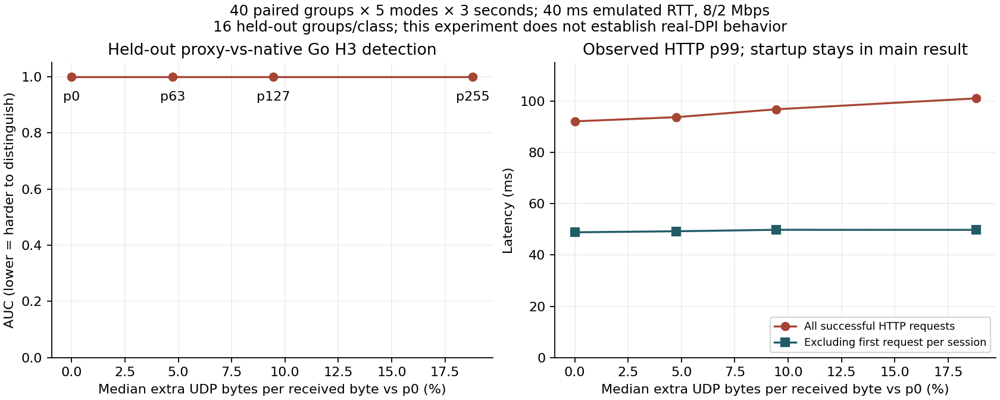
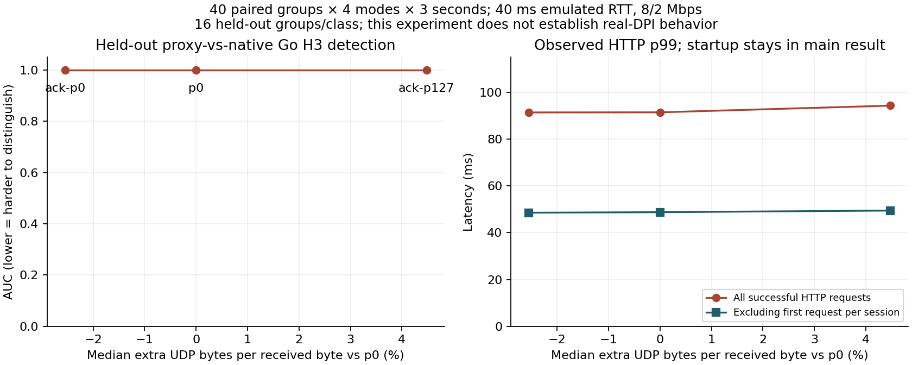

# v0.3 研究：可观察性、填充消融与 ACK 合并

更新：2026-11-10。本页记录研发证据；文档版本不表示部署已经升级。恢复算法、部署二进制与提交关系由本轮总报告另行记录。

**目前最明确的识别结论是负结果：v0.2 的随机记录填充花费约 5%–19% 额外承载字节，却没有降低本实验中“代理与原生 Go H3 流式应用”的可区分性。** 随后实现的 ACK 合并在独立新批次节省约 2.55% UDP 字节、13.36% 数据报数，但检测 AUC 仍为 1。成本改进与抗识别改进需要分别报告。ECH 与真实 HTTP 解决了具体协议和握手隐私问题，但没有消除外部包数、包长、突发和连接行为。

## 观察者与实际可见边界

| 观察者 | 在本实现中可研究的内容 | 不应当归入该观察者的内容 | 证据 |
| --- | --- | --- | --- |
| 沿途被动、无会话密钥 | 目的 IP/端口、TCP/UDP、方向、数据报/包长、连接起止、突发、空闲与多连接关系；TCP TLS 的明文握手部分；QUIC 版本、可见连接标识字段与公开 Initial 密钥可解出的 CRYPTO | TLS 1.3 ServerHello 后的证书消息；加密 H2/H3 HEADERS、SETTINGS、认证值、内层数据；QUIC 1-RTT 内 ACK、流 ID、包号等受保护内容 | [RFC 8446 §2](https://www.rfc-editor.org/rfc/rfc8446.html#section-2)、[RFC 9001 §5](https://www.rfc-editor.org/rfc/rfc9001.html#section-5)、原生 ClientHello 留存 |
| 沿途被动、开启 ECH | 实际 ClientHelloOuter 的 SNI、扩展顺序/长度、外层 ALPN、key share、ECH 扩展与本实现放在 outer 中的客户端 QUIC transport parameters | ECH inner SNI、inner-only 扩展；不能仅见 ECH 扩展就断言接受；服务端 transport parameters 在加密 EncryptedExtensions 中 | [H3/ECH 原生外层解析](../results/recognition-native-final2-full-20261107/native-h3-ech-on-clienthello.json) |
| 主动探测、自建连接 | 自己连接上的完整协商、证书/SAN/信任链、响应、错误和时序；有公开 ECH 配置时可建立自己的 ECH 连接 | 不能由此解密别人的会话；主动取得私有 CA 证书与被动看见证书是不同命题 | [v0.2 主动观察](../results/recognition-http-v02-20261107/ANALYSIS.md)、`internal/cover` |
| 受控终止点 | 本端真实 ECHAccepted、认证结果、H2/H3 状态、HTTP 字段、流与调度日志 | 不能把这些内部字段直接喂给声称为沿途 DPI 的分类器 | `internal/carrier/web_tls.go`、`tools/shapebench/main.go` |
| 可干扰路径者 | 在明确范围内丢包、加延迟、限速、阻断后，观察连接竞速、备用、切换与停顿 | 干扰成本和可控制方向须明确；仅从停顿长度不能推断 QUIC PTO 或封锁实施者 | 本轮恢复实验；本页 shaping 只使用受控延迟/序列化，不进行真实封锁推断 |

在已留存的一条 H3/ECH ClientHello 中，outer 的 ALPN 是 `h3`，扩展 57 可解析客户端流窗口 65536、连接窗口 524288、并发双向/单向流上限 128/8、空闲超时 12000ms 等参数。它们是**该版本和配置的实测外部字段**，不是“QUIC 所有信息均公开”的结论。Initial 公共密钥解密也不提供后续会话密钥。包长/时序可能间接反映加密 HTTP 行为，但沿途观察者没有因此获得明文 SETTINGS 或请求头。

本轮分类器刻意不使用 IP、端口、名称、证书、外层握手、文件名、绝对时钟、seed 或进程标识，只研究业务阶段的方向/长度/相对时序。这样还能轻易区分，说明握手字段并不是剩余的唯一问题。

## ECH、证书与回落的独立作用

`WebClientTLS` 使用 Go 标准 TLS/HPKE；非 nil 的 ECHConfigList 会建立持续有效的 `requireECH` 检查，在 VerifyConnection 中要求 `ECHAccepted=true`。H2/H3 都采用这套配置，拒绝后不去掉 ECH 重新拨号。手动配置文件在启动时读取；当前没有自动 DNS 获取、刷新或密钥轮换状态机。服务端 keygen 产物支持 `SendAsRetry`，而客户端没有自动消费 retry_configs。过期配置被拒绝，操作者更新配置后可进行新的加密重试；不能将测试中的显式加密重试写成已部署自动重试。

2026-11-10 实际重跑 `go test ./internal/carrier -run 'TestWeb(ECH|TLS)' -count=1 -v`，九个顶层测试通过，包含真实 H2/H3 请求的接受状态、H3 拒绝时零应用请求、过期密钥后调用方显式加密重试、错误 CA/名称/pin、TLS resumption 仍检查 pin、删掉 ECH 配置不能成功降级。它们是当前源码的本地功能证据，不代替 VPS 二进制的状态核验。旧原生抓取里的 ECHAccepted 来自另一个诊断连接，报告保持这一来源区分。新 shaping 原生参照的 40/40 条连接直接记录了 ECHAccepted=true；代理一侧仍通过其失败即终止的代码路径与成功业务验证。

ECH 隐藏 inner 握手内容，匿名集合取决于共用端点及一致的外部行为。[RFC 9849 §1、§8、§10](https://www.rfc-editor.org/rfc/rfc9849.html) 不支持“独立 VPS 启用 ECH 就混入大站流量”的推论。私有 CA 是信任/互通问题；同证书包含 inner/outer SAN 是主动枚举问题；TLS 1.3 被动证书不可读是加密层事实。公开证书和独立真实站点有助于信任与访客行为，但不会自动改变 1-RTT 包数或建立共享匿名集。

普通/错误认证请求由同一个 cover handler 处理，避免直接暴露代理入口错误。v0.2 的响应字段匹配有其价值，但未覆盖负载条件下的完整时序分布。保留默认站点模板、独特目的 IP、Go TLS/QUIC 栈与端口关系仍可能提供简单特征。本轮没有浏览器拟态实现，因此选择明确的 Go H3 流式应用作同栈参照；它不是 Chrome、普通网站总体或手机应用总体。

## 固定 v0.2 的填充预算实验

接续进入工作区时已有 2026-11-07 的 200 条未分析会话，本轮保留原始数据并完成审计/复算。冻结程序 SHA256 为 `8a8fd8b25be1eed3882d0396c5ca311fb51048fb75ba190dc9cfebdde63f4c2d`；负责人使用 `git archive e4c93d9`、Go 1.27.1 和相同构建选项重建得到了相同哈希。它不是把后来修改的工作区冒充基线。

数据与方法见 [manifest](../results/shaping-v03-20261107/manifest.json)、[原始分析登记](../results/shaping-v03-20261107/analysis-preregistration.json)、[可运行工具](../tools/shapebench/README.md)。每组共享 workload seed，每条会话 fresh 进程/连接；模式顺序打乱。每组原生 H3、p0、p63、p127、p255 五种条件，每条 3 秒，24 组训练后采集 16 组留出。HTTP 4/6/8 RPS、响应 384/768/1024/1536 字节、SSE 40/50/70ms 间隔、背景源速率 1.2/1.6/2 Mbps 在组间变化。所有模式均经过实际 UDP relay，单向 20ms 延迟，按 IPv4+UDP 成本进行上下行 2/8 Mbps 序列化。

分析登记发生在采集开始之后、留出组开始之前；三个当时源码的 SHA256 与登记吻合。这是可审计的本地记录，并不是不可更改的外部预注册。本轮另行记录分析器修复：原版因 numpy int64 无法 JSON 序列化而未生成结果；等价数值收缩消除了本机矩阵运算警告，并加入非有限数检查。12 个拟合与原登记算法对比，最大分数差 `3.56e-15`；全部留出预测相同。两个训练阈值边界仅有约 `1e-16` 舍入差异，单独记录，没有静默抹去。详见 [修复审计](../results/shaping-v03-20261107/analysis-audit-20261110.json)。

| 填充上限 | 配对额外 UDP 承载成本中位数 | 全部成功 HTTP p95 / p99 ms | 后续 HTTP p99 ms，去掉各会话首次请求 | SSE 最大接收间隔 ms | 全特征留出 AUC |
| --- | ---: | ---: | ---: | ---: | ---: |
| 0 | 0% | 47.85 / 92.10 | 48.86 | 119.87 | 1.000 |
| 63 | +4.74% | 48.75 / 93.72 | 49.26 | 91.63 | 1.000 |
| 127 | +9.44% | 48.54 / 96.80 | 49.83 | 88.25 | 1.000 |
| 255 | +18.80% | 48.87 / 101.05 | 49.80 | 83.27 | 1.000 |

这里的“额外成本”先按每会话的双向 UDP payload / 接收应用字节归一化，再与同组 p0 相除。计数含握手、health、传输 ACK/重传与退出，不含 IP 头；另给逐数据报加 28 字节的 IPv4 估计。分母包含 HTTP body、SSE token payload、下载内容，不含请求与内层语法，故不是纯协议开销率。历史字段名为 `validated_received_bytes`，但审计发现旧 helper 只逐字节校验 HTTP/download，对 SSE 仅检查 JSON/序号并计入 payload 长度，未比较 payload 字符串；此限制同时适用于后面的 ACK 正式批次，不能追认为完整 SSE 内容校验。后续工具已补 payload 比较并另跑验证，不改写原样本。p127 的配对 IPv4 成本增幅中位数约 8.75%，这与 UDP 9.44% 的分母不同，不能互换。旧“约 10%”源于无人工 RTT、无链路限速的 loopback 12 秒实验；本次是新环境对相似成本量级的独立测量。

完整业务分母：native HTTP 752 成功/10 截止删失；p0 751/11；其余每组 752/10。共 3759 成功、51 截止删失，无失败或请求超时；成功时延不包含删失，但两者同时报告。SSE 收到 10836 个事件，200 条连接，零连接失败、已收到事件的序列/解析错误或意外结束；200 个 SSE 和 200 个无限下载均在实验结束时正常删失。每个收到的 SSE 事件携带的源端生成时刻及客户端到达记录保留；它不是完整源端日志，不能枚举截止后仍未到达的事件。relay 零丢包/错误，受管进程全退出 0，无强制 kill；时钟映射最大误差 26.375μs。详见 [analysis.json](../results/shaping-v03-20261107/analysis.json)、[audit.json](../results/shaping-v03-20261107/audit.json)。

全部 HTTP p99 包含首次流建立和并发初始化。后续请求 p99 约 49ms；不能把总体 p99 的 92→97ms 全部归因于 padding，也不能凭短会话的 SSE 最大值宣布填充改善尾延迟。没有测量本轮固定填充的饱和拥塞、移动网络或 CPU/内存成本。

## 检测器与不确定性

检测任务是 **PROTO-X 代理用途 vs 同栈原生 Go H3 流式应用**。33 个简单特征来自两方向包长分位数/均值/比例、数据报数、字节速率、间隔与突发。训练时进行归一化，固定 L2=1 logistic；同组五条会话不跨训练/测试。分别使用全特征、仅长度、仅时序/计数；还分别测试 p0 冻结检测器与每模式重训的检测器。所有组合的留出 AUC 均为 1。这些共享数据的消融不是多份独立的总体证明。

全特征、p0 训练固定阈值下，16/16 代理命中、1/16 原生误报，即 TPR 100% [80.64%,100%]、FPR 6.25% [1.11%,28.33%]（Wilson 95%）。去掉包长和字节速率，仅时序/计数仍是 AUC=1，TPR 16/16、FPR 0/16；零误报的上界仍为 **19.36%**。不能报告“在 1% FPR 下检测率 100%”。AUC 的 2000 次配对组 bootstrap 得到退化区间 [1,1]，它只反映这 16 个简单留出组内部的完全分离，不代表总体 AUC 无不确定性。

这里没有同一会话碎片泄漏，也没有身份字段直接泄漏；但只采一台机器、一个 relay 环境、同一 Go/quic-go 家族、短会话和有限负载。代理路径额外封装 TCP/会话语义，原生参照直接使用 H3；这是声明任务的真实差异，但不能泛化为所有真实应用类别。留出是在同一批次较晚采集，不能称作跨天/跨网络泛化。v0.2 已有参数没有在本留出数据上调优；本轮看过它以后，后续算法需要新的留出集。

## 从观测到下一项机制

无填充时，原生参照平均上/下行 140.50/238.24 包每秒，代理为 300.97/433.24；上行小于 1ms 的包间隔占比 14.93% vs 59.09%。填充上限提高主要改变长度，包数差仍在。源代码中，每次收到新 Data 都请求累计会话 ACK；会话 ACK 又位于本身可靠的 H2/H3 内。它对恢复偏移和窗口释放有用，但并不要求每个 DATA 立刻单独发一个记录。这是 ACK 合并的具体信息来源：累计偏移、窗口余量和 RTT，而不是任意随机睡眠。

本轮新增可消融的 `ack_coalesce` 候选由会话层实现：对普通累计 ACK 合并，最大等待 `clamp(RTT/4, 1ms, 10ms)`；无 RTT 样本时 5ms。窗口进展达到四分之一、FIN、重复/不连续数据及新代次立即确认。它不延后向应用交付数据，也不复制业务请求。此规则应在降低冗余 ACK 与窗口阻塞之间取舍；高吞吐小窗口、极低 RTT 或恢复边界可能抵消收益，必须测量。

新的独立四模式批次使用同一候选二进制 `cb600fd983ef02edfb8e8547fa0c78661a1cf4ea266a555aa05e630915c83dcc`，两端显式 `recovery_mode=legacy`，只有 ACK 开关与填充不同；固定 native / p0 / ack-p0 / ack-p127，采用新 seed family 20261110。仍为 24 组训练+16 组留出、每条 3 秒、相同 40ms RTT 和 8/2 Mbps 条件。采集前自动冻结分析代码和分组规则，旧 200 会话只作探索依据；160/160 会话完成后才分析，没有利用早出样本调参。

| 候选模式 | 对同批 p0 的 UDP 成本中位数 | 上/下行包数每秒 | 全部 HTTP p95 / p99 ms | SSE 接收减源间隔 p99 ms | 全特征留出 AUC |
| --- | ---: | ---: | ---: | ---: | ---: |
| p0，ACK 关闭 | 0% | 316.48 / 453.40 | 46.80 / 91.42 | 2.441 | 1.000 |
| ack-p0 | −2.55% | 265.71 / 401.28 | 46.61 / 91.37 | 2.438 | 1.000 |
| ack-p127 | +4.48% | 268.06 / 401.06 | 47.77 / 94.27 | 2.620 | 1.000 |

ack-p0 的 UDP 成本变化配对组 bootstrap 95% 区间为 [−2.64%,−2.45%]；逐包加入 IPv4+UDP 头后变化为 −3.31% [−3.51%,−3.23%]。业务窗口包数合计下降 13.36%。去掉首次 HTTP 后 p99 为 48.77→48.55ms；这里没有足够证据声称正常交互速度有稳定改善。原生参照上/下行仍为 144.78/245.52 包每秒，说明 ACK 合并只减少了一部分差异。新批次未含 ACK 关闭的 p127，不能直接把本次 +4.48% 与旧批次 +9.44% 的差解释为同条件填充消融。

为检查历史 SSE 内容校验不足对成本分母的影响，事后完全移除 SSE 字节，仅用逐字节校验的 HTTP/download 内容重算：ack-p0 的 UDP/IPv4 成本中位数仍为 −2.55%/−3.31%，旧批次 p127 UDP 成本仍约 +9.45%。这是分母敏感性检查，不是补造 SSE 完整性证明。

每模式均有 HTTP 736 成功+11 截止删失，零失败/超时；总计 2944 成功、44 删失。SSE 共收到 9143 个事件、160 条连接，零连接失败、已收到事件的序列/解析错误、重连或意外结束；全部 SSE/无限下载在截止时删失。relay 零丢包/错误，进程全退出 0，无强制 kill；时钟映射最大误差 27.958μs。数据、源快照和成本/检测结果见 [manifest](../results/shaping-v03-ack-20261110/manifest.json)、[source-manifest](../results/shaping-v03-ack-20261110/source-manifest.json)、[analysis](../results/shaping-v03-ack-20261110/analysis.json)、[audit](../results/shaping-v03-ack-20261110/audit.json)。

原始尾部也保留：ack-p0 的最大 SSE 接收间隔为 110.076ms，p0 为 73.914ms。定位到 `g034-1-ack-p0` 的事件 28，源端生成间隔已为 107.556ms，接收相对源间隔增加 2.520ms；不能把全部 110ms 归因于 ACK。具体源端调度为什么延迟尚未分离。接收间隔减源间隔的 p99 几乎相同；max 为 p0 21.77ms、ack-p0 7.14ms，只作为这批短样本的描述，不推广为长期尾延迟保证。ack-p127 的 HTTP 最大值 149.30ms 也保留。

三个特征集合、冻结 p0 与逐模式重训的全部 AUC 仍为 1。固定 p0 全特征检测器对每个代理模式均 16/16 命中、2/16 原生误报；不同重训模型出现 1 个误报的变化，既不是足够的低误报证据，也不是代理用途变得难识别的证据。ACK 合并的保留依据是减少冗余记录/数据报和字节；本实验没有支持“它提高了抗识别能力”。

另做事后跨批次检查：仅用 11 月 7 日训练组拟合原 p0 模型/阈值，直接评估 11 月 10 日全部 40 组，不用新样本重训或归一化。三个特征集合对三个新代理模式仍 AUC=1、命中 40/40；全特征、长度、时序模型分别误报 4/40、2/40、1/40 原生样本。数据见 [cross-date-transfer.json](../results/shaping-v03-ack-20261110/cross-date-transfer.json)。这证明该批特征跨采集日期与 seed 仍可用，适用范围仍是同一主机/模拟器/实现家族；它是事后诊断，不冒充额外预注册实验或跨网络泛化。

工具层面，新 helper 已增加 SSE payload 逐字节比较，单独的 [4 会话验证 pilot](../results/shaping-v03-sse-check-pilot-20261110/manifest.json) 使用新 helper 与原 v0.2 冻结程序验证该字段；它不补算进两组正式实验。新的代码不会把明确无效的 SSE 内容计入接收字节。原始两批只验证 JSON/序号的限制仍保留。

## 后续优先级

1. ACK 合并已有成本收益，应继续在窄带拥塞、不同 RTT、小窗口和长运行下检查信用释放与恢复边界；普通请求/SSE的本轮结果不替代这些条件。
2. 进一步在带宽紧张、非对称拥塞、不同 RTT 和突发应用下测量 ACK/队列策略，与精确 v0.2 和简单固定 ACK 定时器对照。只有新增机制相对这些简单替代也有收益，才支持更强算法论证。
3. 真正抗识别评估需要多种长连接/流式应用、不同网络与独立实现的参照，外加未参与调参的未来样本；先检查参数、端点与主动分支等确定性特征，再扩大统计检测。

本轮没有 VLESS + REALITY + Vision 或 Hysteria2 的抗识别对照，没有俄罗斯家宽/移动网 DPI 数据，没有浏览器一致性拟态，也没有把 AUC 当作在线可读取的风险。Maybenot 的框架适合表达状态机与预算，但其网站流量分析防御结论不能直接移植为代理发现防御。本轮核对的原始来源、抓取时间和 SHA256 见 [sources.json](../results/recognition-v03-20261110/sources.json)。
